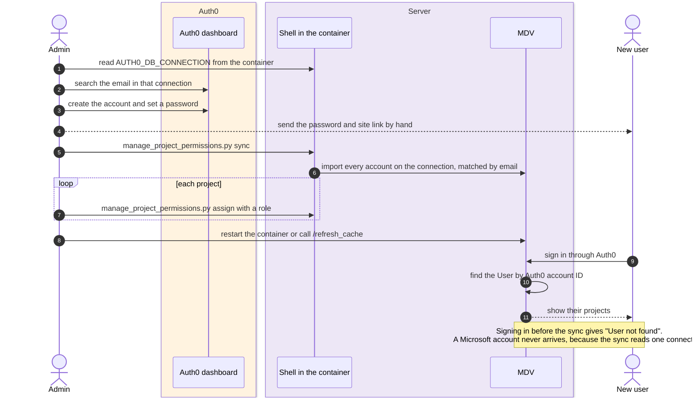
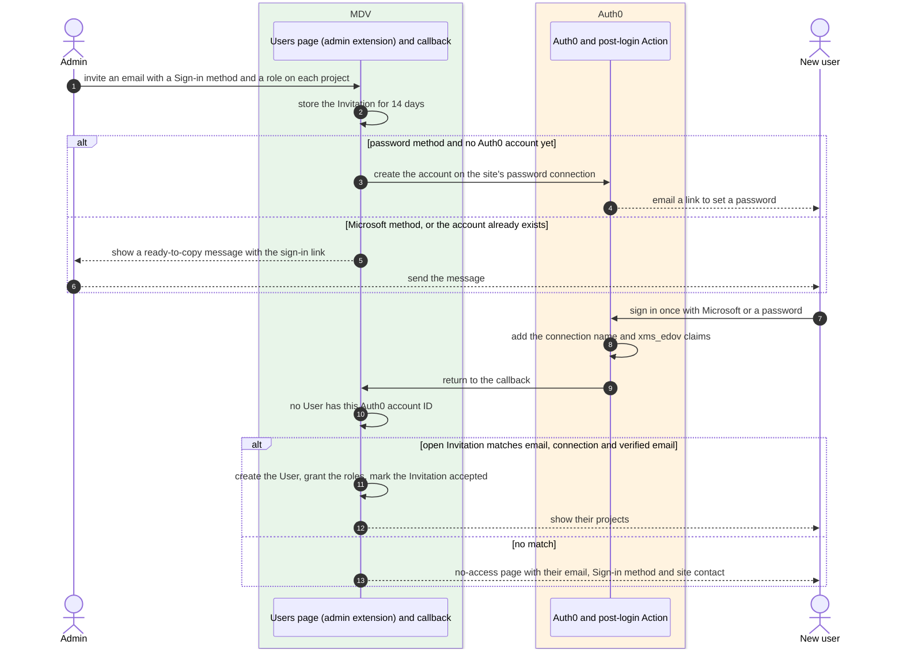

# MDV owns Users and access, and Auth0 only signs people in

**Status:** accepted

## Context

On Auth0 sites a person had to exist in Auth0 before MDV knew about them.
`manage_project_permissions.py`, or an optional sync at startup, imported Auth0 accounts from
the site's one password connection (`auth/auth0_provider.py:843`). The import matched
accounts to Users by email and overwrote the stored Auth0 account ID
(`UserService.add_or_update_user`, `dbutils/dbservice.py:779`), so a person with 2 Auth0
accounts switched between them on each sync. Admin rights came from an `admin` role defined
once for the whole Auth0 tenant (`_fetch_admin_auth_ids`, `auth/auth0_provider.py:574`), while
Project roles lived in MDV's database.

A client on the Cartography site needs its staff to sign in with Microsoft accounts. Auth0
creates a Microsoft user only when that person first signs in, so the sync model forces a
double sign-in: once so Auth0 creates the account, then again after an admin has synced it.

## Decision

On Auth0 sites, MDV decides who has access, and Auth0 only proves who someone is.

An Admin gives a new person access by sending an Invitation. The Invitation names an email
address, the Sign-in method the person must use, and a Project role on each chosen project.
It lasts 14 days, and a resend starts a new 14 days. The person's first sign-in accepts it,
creates their User and grants the projects, so they see their projects straight away. An
Invitation sent to an existing User moves them to a new Sign-in method and can carry a new
email. Inviting the email of an active User grants the projects directly. Inviting a
Deactivated user reactivates them with their earlier Project roles, and a role chosen in the
Invitation replaces the earlier role on that project. It does not restore Admin rights, which
an Admin has to give again. Invitations are kept after they are
accepted, revoked or expired, so a User's history shows who invited them.

Admin rights live only in MDV. Only Admins can invite people. Owners keep sharing their
projects with existing Users through the share dialog. A deployment cannot lose its last
active Admin.

Someone who signs in with no User and no matching Invitation sees a no-access page. It shows
the email and Sign-in method they used, the contact configured for the site and a link to sign
out, so they can try another account.

For password Invitations, MDV asks Auth0 to email the person a link to set their password. If
they already have an account on that connection, MDV reuses it and sends no email. For those
people and for Microsoft Invitations, the users page shows a message with the sign-in link
for the Admin to send.

An admin extension provides the users page, and MDV core keeps the sign-in checks (see
ADR 0022).

## How an Admin adds a new User

Before this decision, an Admin worked in the Auth0 dashboard and a shell on the server, and
the running app saw the new permissions only after a restart or a call to `/refresh_cache`.
The sync reads one password connection, so it never imports a Microsoft account.

With Invitations, the Admin works only in MDV and the person signs in once.

## Migration

Each Auth0 site runs the old sync one last time, which imports every account on its password
connection and copies the Auth0 `admin` role into MDV. After that, the startup sync, the
`admin` role lookup and `manage_project_permissions.py` are removed.
`MDV_BOOTSTRAP_ADMIN_EMAIL` still creates the first Admin on a new site.

Sites on the dummy provider keep their current user creation. No site uses the Shibboleth
provider to give people access, so this decision and the users page leave it out.

## Considered options

- **Keep the sync and add the Microsoft connection.** Rejected because of the double sign-in.
- **Use Auth0 Organizations for Invitations.** Rejected because MDV would still keep the same
  records. [Organization invitations](https://auth0.com/docs/manage-users/organizations/configure-organizations/invite-members)
  carry roles for the whole Organization, so MDV would still store each Invitation's Project
  roles until the person signs in. Removing an Organization member in Auth0 cannot end MDV's
  own session, so MDV would still need Deactivated users and its check on every request, and
  membership would live in both places. Auth0 accepts a Microsoft invitation when the identity
  provider returns the invited email, which ADR 0021 says is not enough on its own. Each site
  would also need its own Organization and an extra parameter on every sign-in.
- **Store pending Users in the users table.** Rejected because a User's Auth0 account ID
  cannot be empty (`dbutils/dbmodels.py:20`), and a pending User would share the inactive
  state with a Deactivated user (see ADR 0020).
